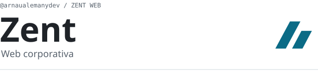
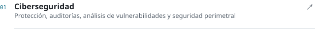
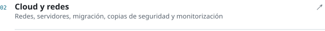
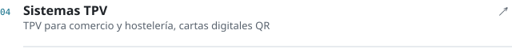
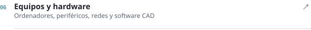
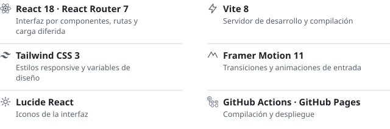

<p align="right"><a href="README.md">EN</a> · <b>ES</b></p>

<picture>
  <source media="(max-width: 600px) and (prefers-color-scheme: dark)" srcset="docs/readme/generated/header-es-dark-m.svg">
  <source media="(max-width: 600px)" srcset="docs/readme/generated/header-es-light-m.svg">
  <source media="(prefers-color-scheme: dark)" srcset="docs/readme/generated/header-es-dark.svg">
  
</picture>

<a href="https://arnaualemanydev.github.io/Zent-Web/">
<picture>
  <source media="(max-width: 600px) and (prefers-color-scheme: dark)" srcset="docs/readme/generated/demo-es-dark-m.svg">
  <source media="(max-width: 600px)" srcset="docs/readme/generated/demo-es-light-m.svg">
  <source media="(prefers-color-scheme: dark)" srcset="docs/readme/generated/demo-es-dark.svg">
  
</picture>
</a>

<h3>
<picture>
  <source media="(max-width: 600px) and (prefers-color-scheme: dark)" srcset="docs/readme/generated/section-1-es-dark-m.svg">
  <source media="(max-width: 600px)" srcset="docs/readme/generated/section-1-es-light-m.svg">
  <source media="(prefers-color-scheme: dark)" srcset="docs/readme/generated/section-1-es-dark.svg">
  
</picture>
</h3>

Zent es una web corporativa responsive de una consultora informática ficticia, centrada en equipos, redes y soporte técnico para hogares, oficinas y comercios. La web está en español.

El proyecto nació durante mis prácticas de Desarrollo de Aplicaciones Multiplataforma. Para esta versión de portfolio, conservé la arquitectura original y sustituí la identidad corporativa, los datos de contacto, la ubicación y las referencias comerciales por contenido ficticio.

<h3>
<picture>
  <source media="(max-width: 600px) and (prefers-color-scheme: dark)" srcset="docs/readme/generated/section-2-es-dark-m.svg">
  <source media="(max-width: 600px)" srcset="docs/readme/generated/section-2-es-light-m.svg">
  <source media="(prefers-color-scheme: dark)" srcset="docs/readme/generated/section-2-es-dark.svg">
  
</picture>
</h3>

El catálogo reúne seis áreas de servicio. Cada enlace abre su sección correspondiente en la demo.

<a href="https://arnaualemanydev.github.io/Zent-Web/servicios/#ciberseguridad">
<picture>
  <source media="(max-width: 600px) and (prefers-color-scheme: dark)" srcset="docs/readme/generated/service-1-es-dark-m.svg">
  <source media="(max-width: 600px)" srcset="docs/readme/generated/service-1-es-light-m.svg">
  <source media="(prefers-color-scheme: dark)" srcset="docs/readme/generated/service-1-es-dark.svg">
  
</picture>
</a>

<a href="https://arnaualemanydev.github.io/Zent-Web/servicios/#infraestructura-cloud">
<picture>
  <source media="(max-width: 600px) and (prefers-color-scheme: dark)" srcset="docs/readme/generated/service-2-es-dark-m.svg">
  <source media="(max-width: 600px)" srcset="docs/readme/generated/service-2-es-light-m.svg">
  <source media="(prefers-color-scheme: dark)" srcset="docs/readme/generated/service-2-es-dark.svg">
  
</picture>
</a>

<a href="https://arnaualemanydev.github.io/Zent-Web/servicios/#servicios-gestionados">
<picture>
  <source media="(max-width: 600px) and (prefers-color-scheme: dark)" srcset="docs/readme/generated/service-3-es-dark-m.svg">
  <source media="(max-width: 600px)" srcset="docs/readme/generated/service-3-es-light-m.svg">
  <source media="(prefers-color-scheme: dark)" srcset="docs/readme/generated/service-3-es-dark.svg">
  
</picture>
</a>

<a href="https://arnaualemanydev.github.io/Zent-Web/servicios/#sistemas-tpv">
<picture>
  <source media="(max-width: 600px) and (prefers-color-scheme: dark)" srcset="docs/readme/generated/service-4-es-dark-m.svg">
  <source media="(max-width: 600px)" srcset="docs/readme/generated/service-4-es-light-m.svg">
  <source media="(prefers-color-scheme: dark)" srcset="docs/readme/generated/service-4-es-dark.svg">
  
</picture>
</a>

<a href="https://arnaualemanydev.github.io/Zent-Web/servicios/#telecomunicaciones">
<picture>
  <source media="(max-width: 600px) and (prefers-color-scheme: dark)" srcset="docs/readme/generated/service-5-es-dark-m.svg">
  <source media="(max-width: 600px)" srcset="docs/readme/generated/service-5-es-light-m.svg">
  <source media="(prefers-color-scheme: dark)" srcset="docs/readme/generated/service-5-es-dark.svg">
  
</picture>
</a>

<a href="https://arnaualemanydev.github.io/Zent-Web/servicios/#equipos-hardware">
<picture>
  <source media="(max-width: 600px) and (prefers-color-scheme: dark)" srcset="docs/readme/generated/service-6-es-dark-m.svg">
  <source media="(max-width: 600px)" srcset="docs/readme/generated/service-6-es-light-m.svg">
  <source media="(prefers-color-scheme: dark)" srcset="docs/readme/generated/service-6-es-dark.svg">
  
</picture>
</a>

La web también incluye una [página de descargas](https://arnaualemanydev.github.io/Zent-Web/descargas/) con una guía de soporte local y enlaces a fabricantes, una [página de contacto](https://arnaualemanydev.github.io/Zent-Web/contacto/) con datos ficticios y páginas de aviso legal, privacidad y cookies.

<h3>
<picture>
  <source media="(max-width: 600px) and (prefers-color-scheme: dark)" srcset="docs/readme/generated/section-3-es-dark-m.svg">
  <source media="(max-width: 600px)" srcset="docs/readme/generated/section-3-es-light-m.svg">
  <source media="(prefers-color-scheme: dark)" srcset="docs/readme/generated/section-3-es-dark.svg">
  
</picture>
</h3>

**01 / Interacciones accesibles**  
Las tarjetas de servicios muestran sus detalles mediante el ratón, un botón operable con teclado y la interacción táctil. Utilizan `aria-expanded`, admiten Escape y enlazan con las secciones del catálogo. Véase [`ServiceCard.jsx`](src/components/ServiceCard.jsx).

**02 / Presentación ligera**  
La cabecera utiliza una pequeña ilustración vectorial en lugar de una imagen rasterizada. La página de inicio se carga con el módulo de entrada; las páginas secundarias se cargan bajo demanda. Véanse [`HeroSection.jsx`](src/components/HeroSection.jsx) y [`App.jsx`](src/App.jsx).

**03 / Identidad visual coherente**  
La paleta azul oscuro y cian, las ilustraciones SVG reutilizables y las variables de diseño mantienen una interfaz coherente. Véanse [`index.css`](src/index.css) y [`tailwind.config.js`](tailwind.config.js).

**04 / Alojamiento estático con rutas en cliente**  
React Router utiliza la ruta base `/Zent-Web/` de Vite. Un script posterior a la compilación genera un `index.html` para cada ruta conocida y un `404.html`, facilitando la navegación directa y las recargas en GitHub Pages. Véase [`pages-routes.mjs`](scripts/pages-routes.mjs).

<h3>
<picture>
  <source media="(max-width: 600px) and (prefers-color-scheme: dark)" srcset="docs/readme/generated/section-4-es-dark-m.svg">
  <source media="(max-width: 600px)" srcset="docs/readme/generated/section-4-es-light-m.svg">
  <source media="(prefers-color-scheme: dark)" srcset="docs/readme/generated/section-4-es-dark.svg">
  
</picture>
</h3>

<picture>
  <source media="(max-width: 600px) and (prefers-color-scheme: dark)" srcset="docs/readme/generated/stack-es-dark-m.svg">
  <source media="(max-width: 600px)" srcset="docs/readme/generated/stack-es-light-m.svg">
  <source media="(prefers-color-scheme: dark)" srcset="docs/readme/generated/stack-es-dark.svg">
  
</picture>

<h3>
<picture>
  <source media="(max-width: 600px) and (prefers-color-scheme: dark)" srcset="docs/readme/generated/section-5-es-dark-m.svg">
  <source media="(max-width: 600px)" srcset="docs/readme/generated/section-5-es-light-m.svg">
  <source media="(prefers-color-scheme: dark)" srcset="docs/readme/generated/section-5-es-dark.svg">
  
</picture>
</h3>

El workflow de despliegue utiliza Node.js 22. Instala Node.js 22 y Git para reproducir el proyecto localmente.

```bash
git clone https://github.com/ArnauAlemanyDev/Zent-Web.git
cd Zent-Web
npm ci
npm run dev
```

Abre la dirección local indicada por Vite (normalmente `http://localhost:5173/Zent-Web/`).

Para compilar y previsualizar la versión de producción:

```bash
npm run build
npm run preview
```

La web compilada se genera en `dist/`. El [workflow de Pages](.github/workflows/pages.yml) la publica al subir cambios a `main` y también permite la ejecución manual.

<h3>
<picture>
  <source media="(max-width: 600px) and (prefers-color-scheme: dark)" srcset="docs/readme/generated/section-6-es-dark-m.svg">
  <source media="(max-width: 600px)" srcset="docs/readme/generated/section-6-es-light-m.svg">
  <source media="(prefers-color-scheme: dark)" srcset="docs/readme/generated/section-6-es-dark.svg">
  
</picture>
</h3>

```text
Zent-Web/
├── src/
│   ├── components/     Estructura, navegación e interfaz reutilizable
│   ├── pages/          Inicio, catálogo, descargas, contacto y legal
│   └── lib/            Hook de título y vista 404
├── public/
│   ├── images/         Marca e ilustraciones de servicios (SVG)
│   └── guia-soporte.txt
├── scripts/            Generación de rutas estáticas
├── docs/readme/        Recursos y mantenimiento del README
└── .github/workflows/  Despliegue en GitHub Pages
```

<h3>
<picture>
  <source media="(max-width: 600px) and (prefers-color-scheme: dark)" srcset="docs/readme/generated/section-7-es-dark-m.svg">
  <source media="(max-width: 600px)" srcset="docs/readme/generated/section-7-es-light-m.svg">
  <source media="(prefers-color-scheme: dark)" srcset="docs/readme/generated/section-7-es-dark.svg">
  
</picture>
</h3>

**Zent ERP** — Aplicación independiente de gestión empresarial dentro del ecosistema Zent. Repositorio aún no publicado.

<sub>Proyecto de portfolio de <a href="https://github.com/ArnauAlemanyDev">Arnau Alemany</a>. Zent es una marca ficticia; los datos de contacto y las referencias comerciales de la demo son ilustrativos.</sub>
