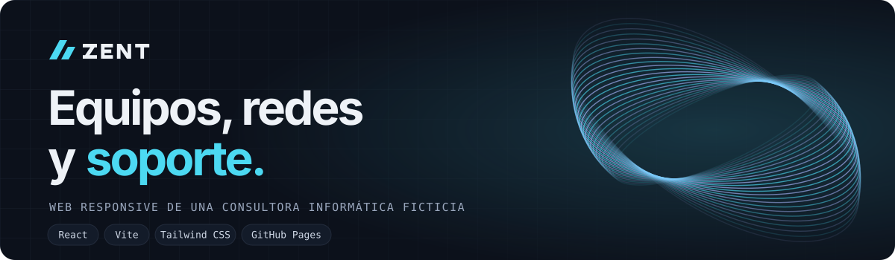
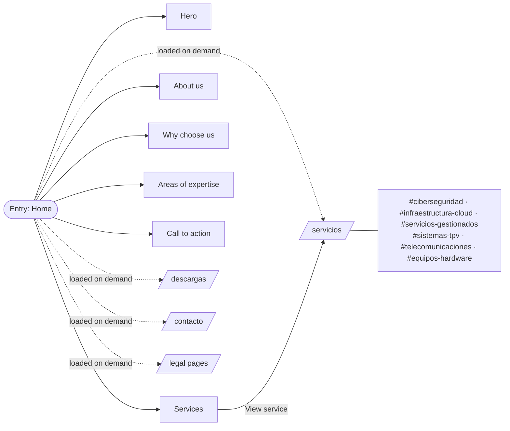

<div align="center">

[ES](README.md) · **EN**

<a href="https://arnaualemanydev.github.io/Zent/">
  <picture>
    <source media="(prefers-color-scheme: dark)" srcset="docs/banner-dark.svg">
    <source media="(prefers-color-scheme: light)" srcset="docs/banner-light.svg">
    
  </picture>
</a>

<br>

[](https://arnaualemanydev.github.io/Zent/)
[](https://arnaualemanydev.github.io/Zent/servicios)

</div>

<br>

## What is Zent

Zent is the website of an IT consultancy that does not exist: installation and maintenance of equipment, networks and support for homes, offices and shops. It brings together **six service areas**, from cybersecurity to point-of-sale systems, in a responsive site with a browsable catalogue, a downloads page and a contact page.

The project started during my DAM work placement as a real website for a company in the sector. To publish it as a portfolio piece I kept the architecture and replaced the corporate identity, contact details, location map and commercial references with demo content. Everything you will see in the demo is fictional. The site itself is written in Spanish.

<br>

## A tour of the catalogue

Each card links straight to its section in the demo.

<table>
  <tr>
    <td width="33%" valign="top">
      <b><a href="https://arnaualemanydev.github.io/Zent/servicios#ciberseguridad">Cybersecurity</a></b><br>
      Multi-device protection, security audits and vulnerability analysis, firewalls and perimeter security.
    </td>
    <td width="33%" valign="top">
      <b><a href="https://arnaualemanydev.github.io/Zent/servicios#infraestructura-cloud">Cloud and networks</a></b><br>
      LAN/WAN networks, physical and virtual servers, cloud migration, backup and monitoring.
    </td>
    <td width="33%" valign="top">
      <b><a href="https://arnaualemanydev.github.io/Zent/servicios#servicios-gestionados">Managed services</a></b><br>
      Remote assistance, preventive maintenance, hardware repair and on-site support.
    </td>
  </tr>
  <tr>
    <td width="33%" valign="top">
      <b><a href="https://arnaualemanydev.github.io/Zent/servicios#sistemas-tpv">Point-of-sale systems</a></b><br>
      POS for hospitality, retail, hairdressers and workshops, with a QR digital menu.
    </td>
    <td width="33%" valign="top">
      <b><a href="https://arnaualemanydev.github.io/Zent/servicios#telecomunicaciones">Telecommunications</a></b><br>
      Fibre, mobile plans, bundled packs and IP phone systems for businesses.
    </td>
    <td width="33%" valign="top">
      <b><a href="https://arnaualemanydev.github.io/Zent/servicios#equipos-hardware">Equipment and hardware</a></b><br>
      Computers, components, peripherals, network equipment and CAD software.
    </td>
  </tr>
</table>

Besides the catalogue, the site includes **Downloads** (an in-house support guide and links to remote assistance tools), a **Contact** page with sample data, and the legal pages for legal notice, privacy and cookies.

<br>

## Development decisions

### A catalogue that works with mouse, keyboard and touch

The six cards keep the same height and their summary opens in three ways: on mouse hover, by activating **Ver detalles** ("View details") with the keyboard, or by tapping it on a touch screen. The button exposes its state with `aria-expanded`, and `Esc` closes the panel and returns focus to the button. **Ver servicio** ("View service") takes you to the matching section and moves focus there, including when a URL such as [`/servicios#sistemas-tpv`](https://arnaualemanydev.github.io/Zent/servicios#sistemas-tpv) is opened directly.

📄 Code: [`src/components/ServiceCard.jsx`](src/components/ServiceCard.jsx) and [`src/pages/Services.jsx`](src/pages/Services.jsx)

### A light first load

The hero illustration is a vector SVG of about 4 kB, [`public/images/filamentos.svg`](public/images/filamentos.svg), instead of a raster image: it stays sharp on any screen and weighs very little. Its lines sway slowly through a CSS animation that is switched off with `prefers-reduced-motion`. The home page is part of the entry module so the headline appears on the first render, and the remaining pages load on demand.

📄 Code: [`src/App.jsx`](src/App.jsx) and [`src/components/HeroSection.jsx`](src/components/HeroSection.jsx)

### A consistent visual identity

Colours live as HSL variables in [`src/index.css`](src/index.css) and are wired into Tailwind in [`tailwind.config.js`](tailwind.config.js). The header, the hero and the closing call to action use the inverse palette: ink-blue background `#0c111b`, light text `#eef2f7` and an electric cyan `#4cd9f2` kept for whatever should catch the eye. The rest of the site works on light surfaces with a deep petrol blue as the main colour. The six service illustrations and the logo are SVGs that share the line language of the hero (`public/images/service-*.svg`). Styles respect `prefers-reduced-motion` and visible focus.

### Routes that survive a reload

Routes are resolved on the client with React Router. Because GitHub Pages serves static files, a post-build script ([`scripts/pages-routes.mjs`](scripts/pages-routes.mjs)) copies `index.html` into every route and into `404.html`, so direct links and reloads work. For other hosts, [`public/_redirects`](public/_redirects), [`public/.htaccess`](public/.htaccess) and [`vercel.json`](vercel.json) are included.

<br>

## Application map



<br>

## Technologies

| Technology | What it is used for here |
| --- | --- |
| **React 18** and **React Router** | Component-based UI, site routes and lazy loading of inner pages |
| **Vite** | Development server and production build under `/Zent/` |
| **Tailwind CSS** | Styling with design variables for the light and inverse palettes |
| **Framer Motion** | Entrance animations and the navigation indicator transition |
| **Lucide** | Icons for services, navigation and downloads |
| **GitHub Actions** | Automatic publishing to GitHub Pages |

<br>

## Repository structure

```text
Zent/
├── src/
│   ├── pages/          Views: Home, Services, Downloads, Contact and legal pages
│   ├── components/     Layout, navigation, cards and Home sections
│   └── lib/            Page title hook and 404 view
├── public/
│   ├── images/         Logo, hero and service illustrations as SVG
│   └── guia-soporte.txt   Local download on the Downloads page
├── scripts/            Route handling for GitHub Pages
├── docs/               Banners for this README
└── .github/workflows/  Publishing to GitHub Pages
```

<br>

<div align="center">

<sub>Portfolio project by <a href="https://github.com/ArnauAlemanyDev">Arnau Alemany</a>. Zent is a fictional brand: contact details, locations and commercial references are for demonstration only.</sub>

</div>
