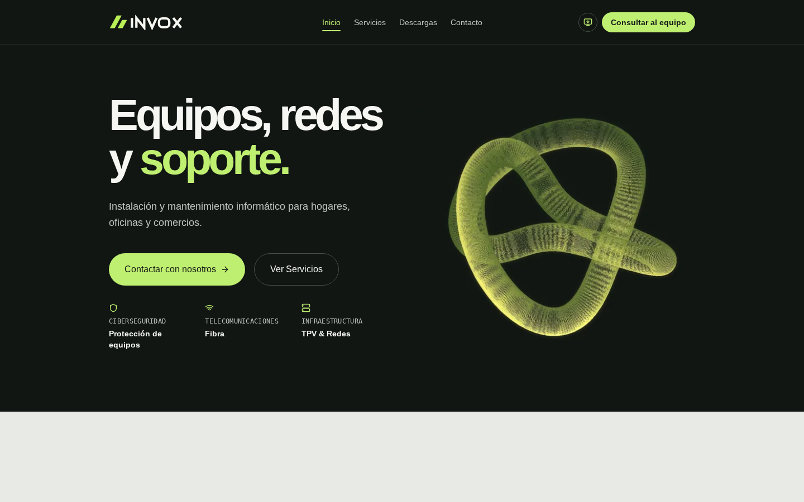

# Invox

Web responsive de una consultora informática ficticia. El catálogo reúne seis áreas de servicio, desde ciberseguridad hasta sistemas de punto de venta.

[Visitar la demo de Invox](https://arnaualemanydev.github.io/invox/)



## Decisiones de desarrollo

- **De proyecto de prácticas a portfolio.** La adaptación conserva la arquitectura de la web y sustituye la identidad corporativa, los contactos, el plano de ubicación y las referencias comerciales por contenido de demostración. La guía de soporte es una descarga local.
- **Un catálogo navegable.** Las seis tarjetas mantienen la misma altura. El resumen se abre al pasar el ratón o al activar «Ver detalles» con teclado o pantalla táctil. «Ver servicio» lleva directamente a la sección correspondiente y coloca allí el foco, también al abrir una URL como `/servicios#sistemas-tpv`.
- **Primera carga.** El navegador selecciona entre dos imágenes WebP de 25 y 79 kB para el hero, frente a los 280 kB iniciales. Inicio forma parte del módulo de entrada y el titular aparece desde su primer render. Las páginas interiores se cargan bajo demanda.

## Ejecutar el proyecto

Con Node.js 22 y npm, ejecuta en la raíz del repositorio:

```sh
npm ci
npm run dev
```

Para revisar la compilación de producción:

```sh
npm run build
npm run preview
```

El sitio se sirve bajo `/invox/`. En GitHub, selecciona **Settings → Pages → Source → GitHub Actions**. El flujo incluido publica los cambios de `main`.

El resultado se genera en `dist/`. En un alojamiento estático, las rutas de la aplicación deben resolverse a `index.html` para permitir accesos directos al catálogo.

## Tecnologías

React, React Router, Vite, Tailwind CSS, Framer Motion y Lucide. Las vistas están en `src/pages/`, los componentes compartidos en `src/components/` y los recursos gráficos en `public/images/`.
