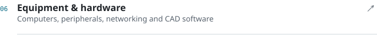
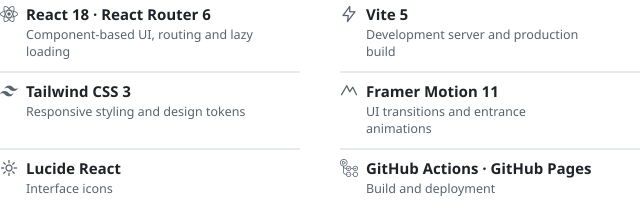

<p align="right"><b>EN</b> · <a href="README.es.md">ES</a></p>

<picture>
  <source media="(max-width: 600px) and (prefers-color-scheme: dark)" srcset="docs/readme/generated/header-en-dark-m.svg">
  <source media="(max-width: 600px)" srcset="docs/readme/generated/header-en-light-m.svg">
  <source media="(prefers-color-scheme: dark)" srcset="docs/readme/generated/header-en-dark.svg">
  
</picture>

<a href="https://arnaualemanydev.github.io/Zent-Web/">
<picture>
  <source media="(max-width: 600px) and (prefers-color-scheme: dark)" srcset="docs/readme/generated/demo-en-dark-m.svg">
  <source media="(max-width: 600px)" srcset="docs/readme/generated/demo-en-light-m.svg">
  <source media="(prefers-color-scheme: dark)" srcset="docs/readme/generated/demo-en-dark.svg">
  
</picture>
</a>

<h3>
<picture>
  <source media="(max-width: 600px) and (prefers-color-scheme: dark)" srcset="docs/readme/generated/section-1-en-dark-m.svg">
  <source media="(max-width: 600px)" srcset="docs/readme/generated/section-1-en-light-m.svg">
  <source media="(prefers-color-scheme: dark)" srcset="docs/readme/generated/section-1-en-dark.svg">
  
</picture>
</h3>

Zent is a responsive corporate website for a fictional IT consultancy, covering equipment, networks and technical support for homes, offices and shops. The website is in Spanish.

The project originated during my Multiplatform Application Development work placement. For this portfolio edition, I retained the original architecture and replaced the company's identity, contact details, location and commercial references with fictional content.

<h3>
<picture>
  <source media="(max-width: 600px) and (prefers-color-scheme: dark)" srcset="docs/readme/generated/section-2-en-dark-m.svg">
  <source media="(max-width: 600px)" srcset="docs/readme/generated/section-2-en-light-m.svg">
  <source media="(prefers-color-scheme: dark)" srcset="docs/readme/generated/section-2-en-dark.svg">
  
</picture>
</h3>

Six service areas form the catalogue. Each link opens its corresponding section in the demo.

<a href="https://arnaualemanydev.github.io/Zent-Web/servicios/#ciberseguridad">
<picture>
  <source media="(max-width: 600px) and (prefers-color-scheme: dark)" srcset="docs/readme/generated/service-1-en-dark-m.svg">
  <source media="(max-width: 600px)" srcset="docs/readme/generated/service-1-en-light-m.svg">
  <source media="(prefers-color-scheme: dark)" srcset="docs/readme/generated/service-1-en-dark.svg">
  
</picture>
</a>

<a href="https://arnaualemanydev.github.io/Zent-Web/servicios/#infraestructura-cloud">
<picture>
  <source media="(max-width: 600px) and (prefers-color-scheme: dark)" srcset="docs/readme/generated/service-2-en-dark-m.svg">
  <source media="(max-width: 600px)" srcset="docs/readme/generated/service-2-en-light-m.svg">
  <source media="(prefers-color-scheme: dark)" srcset="docs/readme/generated/service-2-en-dark.svg">
  
</picture>
</a>

<a href="https://arnaualemanydev.github.io/Zent-Web/servicios/#servicios-gestionados">
<picture>
  <source media="(max-width: 600px) and (prefers-color-scheme: dark)" srcset="docs/readme/generated/service-3-en-dark-m.svg">
  <source media="(max-width: 600px)" srcset="docs/readme/generated/service-3-en-light-m.svg">
  <source media="(prefers-color-scheme: dark)" srcset="docs/readme/generated/service-3-en-dark.svg">
  
</picture>
</a>

<a href="https://arnaualemanydev.github.io/Zent-Web/servicios/#sistemas-tpv">
<picture>
  <source media="(max-width: 600px) and (prefers-color-scheme: dark)" srcset="docs/readme/generated/service-4-en-dark-m.svg">
  <source media="(max-width: 600px)" srcset="docs/readme/generated/service-4-en-light-m.svg">
  <source media="(prefers-color-scheme: dark)" srcset="docs/readme/generated/service-4-en-dark.svg">
  
</picture>
</a>

<a href="https://arnaualemanydev.github.io/Zent-Web/servicios/#telecomunicaciones">
<picture>
  <source media="(max-width: 600px) and (prefers-color-scheme: dark)" srcset="docs/readme/generated/service-5-en-dark-m.svg">
  <source media="(max-width: 600px)" srcset="docs/readme/generated/service-5-en-light-m.svg">
  <source media="(prefers-color-scheme: dark)" srcset="docs/readme/generated/service-5-en-dark.svg">
  
</picture>
</a>

<a href="https://arnaualemanydev.github.io/Zent-Web/servicios/#equipos-hardware">
<picture>
  <source media="(max-width: 600px) and (prefers-color-scheme: dark)" srcset="docs/readme/generated/service-6-en-dark-m.svg">
  <source media="(max-width: 600px)" srcset="docs/readme/generated/service-6-en-light-m.svg">
  <source media="(prefers-color-scheme: dark)" srcset="docs/readme/generated/service-6-en-dark.svg">
  
</picture>
</a>

The site also includes a [downloads page](https://arnaualemanydev.github.io/Zent-Web/descargas/) with a local support guide and vendor links, a [contact page](https://arnaualemanydev.github.io/Zent-Web/contacto/) with fictional details, and legal notice, privacy and cookie pages.

<h3>
<picture>
  <source media="(max-width: 600px) and (prefers-color-scheme: dark)" srcset="docs/readme/generated/section-3-en-dark-m.svg">
  <source media="(max-width: 600px)" srcset="docs/readme/generated/section-3-en-light-m.svg">
  <source media="(prefers-color-scheme: dark)" srcset="docs/readme/generated/section-3-en-dark.svg">
  
</picture>
</h3>

**01 / Accessible interactions**  
Service cards expose their details through mouse hover, a keyboard-operable button and touch. They use `aria-expanded`, support Escape and link to catalogue sections. See [`ServiceCard.jsx`](src/components/ServiceCard.jsx).

**02 / Lightweight presentation**  
The hero uses a small vector illustration instead of a raster image. The home page is loaded with the entry module; secondary pages are loaded on demand. See [`HeroSection.jsx`](src/components/HeroSection.jsx) and [`App.jsx`](src/App.jsx).

**03 / Consistent visual identity**  
The ink-blue and cyan palette, reusable SVG illustrations and design variables form a cohesive interface. See [`index.css`](src/index.css) and [`tailwind.config.js`](tailwind.config.js).

**04 / Static hosting with client-side routing**  
React Router uses Vite's `/Zent-Web/` base. A post-build script creates an `index.html` for each known route plus `404.html`, supporting direct navigation and reloads on GitHub Pages. See [`pages-routes.mjs`](scripts/pages-routes.mjs).

<h3>
<picture>
  <source media="(max-width: 600px) and (prefers-color-scheme: dark)" srcset="docs/readme/generated/section-4-en-dark-m.svg">
  <source media="(max-width: 600px)" srcset="docs/readme/generated/section-4-en-light-m.svg">
  <source media="(prefers-color-scheme: dark)" srcset="docs/readme/generated/section-4-en-dark.svg">
  
</picture>
</h3>

<picture>
  <source media="(max-width: 600px) and (prefers-color-scheme: dark)" srcset="docs/readme/generated/stack-en-dark-m.svg">
  <source media="(max-width: 600px)" srcset="docs/readme/generated/stack-en-light-m.svg">
  <source media="(prefers-color-scheme: dark)" srcset="docs/readme/generated/stack-en-dark.svg">
  
</picture>

<h3>
<picture>
  <source media="(max-width: 600px) and (prefers-color-scheme: dark)" srcset="docs/readme/generated/section-5-en-dark-m.svg">
  <source media="(max-width: 600px)" srcset="docs/readme/generated/section-5-en-light-m.svg">
  <source media="(prefers-color-scheme: dark)" srcset="docs/readme/generated/section-5-en-dark.svg">
  
</picture>
</h3>

The deployment workflow uses Node.js 22. Install Node.js 22 and Git to reproduce the project locally.

```bash
git clone https://github.com/ArnauAlemanyDev/Zent-Web.git
cd Zent-Web
npm ci
npm run dev
```

Open the local address displayed by Vite (normally `http://localhost:5173/Zent-Web/`).

To build and preview the production version:

```bash
npm run build
npm run preview
```

The generated site is placed in `dist/`. The [Pages workflow](.github/workflows/pages.yml) publishes it on pushes to `main` and can also be triggered manually.

<h3>
<picture>
  <source media="(max-width: 600px) and (prefers-color-scheme: dark)" srcset="docs/readme/generated/section-6-en-dark-m.svg">
  <source media="(max-width: 600px)" srcset="docs/readme/generated/section-6-en-light-m.svg">
  <source media="(prefers-color-scheme: dark)" srcset="docs/readme/generated/section-6-en-dark.svg">
  
</picture>
</h3>

```text
Zent-Web/
├── src/
│   ├── components/     Layout, navigation and reusable UI
│   ├── pages/          Home, catalogue, downloads, contact, legal
│   └── lib/            Page title hook and 404 view
├── public/
│   ├── images/         Brand and service illustrations (SVG)
│   └── guia-soporte.txt
├── scripts/            Static route generation
├── docs/readme/        README artwork and maintenance
└── .github/workflows/  GitHub Pages deployment
```

<h3>
<picture>
  <source media="(max-width: 600px) and (prefers-color-scheme: dark)" srcset="docs/readme/generated/section-7-en-dark-m.svg">
  <source media="(max-width: 600px)" srcset="docs/readme/generated/section-7-en-light-m.svg">
  <source media="(prefers-color-scheme: dark)" srcset="docs/readme/generated/section-7-en-dark.svg">
  
</picture>
</h3>

**Zent ERP** — A separate business management application in the Zent ecosystem. Repository not published yet.

<sub>Portfolio project by <a href="https://github.com/ArnauAlemanyDev">Arnau Alemany</a>. Zent is a fictional brand; the contact and commercial information in the demo are illustrative.</sub>
