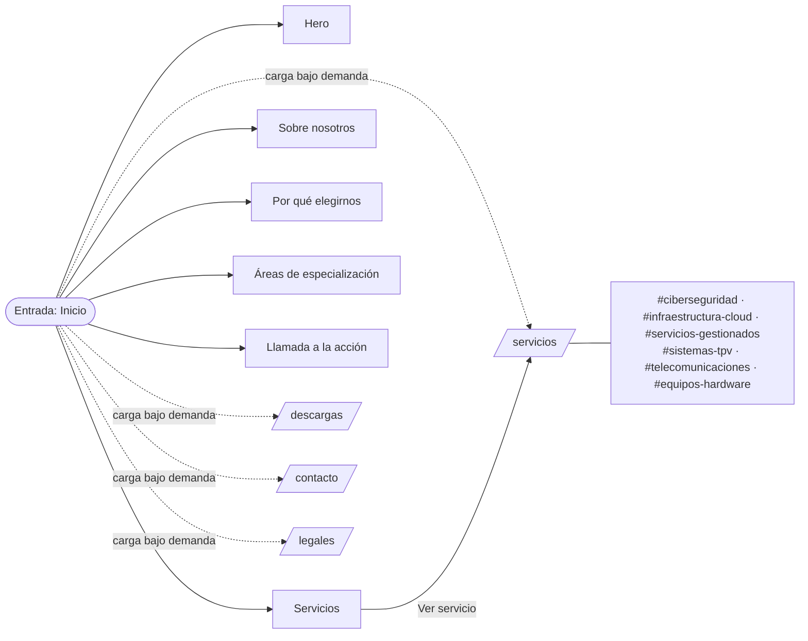

<div align="center">

<a href="https://arnaualemanydev.github.io/Invox/">
  <picture>
    <source media="(prefers-color-scheme: dark)" srcset="docs/banner-dark.svg">
    <source media="(prefers-color-scheme: light)" srcset="docs/banner-light.svg">
    
  </picture>
</a>

<br>

[](https://arnaualemanydev.github.io/Invox/)
[](https://arnaualemanydev.github.io/Invox/servicios)
[](#-ejecutar-el-proyecto)

</div>

<br>

[](https://arnaualemanydev.github.io/Invox/)

<br>

## Qué es Invox

Invox es la web de una consultora informática que no existe: instalación y mantenimiento de equipos, redes y soporte para hogares, oficinas y comercios. Reúne **seis áreas de servicio**, desde ciberseguridad hasta sistemas de punto de venta, en un sitio responsive con catálogo navegable, página de descargas y contacto.

El proyecto nació durante mis prácticas de DAM como web real de una empresa del sector. Para publicarlo como portfolio conservé la arquitectura y sustituí la identidad corporativa, los contactos, el plano de ubicación y las referencias comerciales por contenido de demostración. Todos los datos que verás en la demo son ficticios.

<br>

## Un recorrido por el catálogo

Cada tarjeta lleva directamente a su sección en la demo.

<table>
  <tr>
    <td width="33%" valign="top">
      <b><a href="https://arnaualemanydev.github.io/Invox/servicios#ciberseguridad">Ciberseguridad</a></b><br>
      Protección multidispositivo, auditoría y vulnerabilidades, firewalls y seguridad perimetral.
    </td>
    <td width="33%" valign="top">
      <b><a href="https://arnaualemanydev.github.io/Invox/servicios#infraestructura-cloud">Cloud y redes</a></b><br>
      Redes LAN/WAN, servidores físicos y virtuales, migración a la nube, backup y monitorización.
    </td>
    <td width="33%" valign="top">
      <b><a href="https://arnaualemanydev.github.io/Invox/servicios#servicios-gestionados">Servicios gestionados</a></b><br>
      Asistencia remota, mantenimiento preventivo, reparación de hardware y soporte presencial.
    </td>
  </tr>
  <tr>
    <td width="33%" valign="top">
      <b><a href="https://arnaualemanydev.github.io/Invox/servicios#sistemas-tpv">Sistemas TPV</a></b><br>
      Punto de venta para hostelería, comercio, peluquería y talleres, con carta digital por QR.
    </td>
    <td width="33%" valign="top">
      <b><a href="https://arnaualemanydev.github.io/Invox/servicios#telecomunicaciones">Telecomunicaciones</a></b><br>
      Fibra, telefonía móvil, packs convergentes y centralitas IP para empresas.
    </td>
    <td width="33%" valign="top">
      <b><a href="https://arnaualemanydev.github.io/Invox/servicios#equipos-hardware">Equipos y hardware</a></b><br>
      Ordenadores, componentes, periféricos, equipamiento de red y software CAD.
    </td>
  </tr>
</table>

Además del catálogo, el sitio incluye **Descargas** (una guía de soporte propia y enlaces a herramientas de asistencia remota), **Contacto** con datos de ejemplo y las páginas legales de aviso legal, privacidad y cookies.

<br>

## Decisiones de desarrollo

### Un catálogo que funciona con ratón, teclado y pantalla táctil

Las seis tarjetas mantienen la misma altura y su resumen se abre de tres formas: al pasar el ratón, al activar **Ver detalles** con teclado o al tocarlo en una pantalla táctil. El botón expone su estado con `aria-expanded`, `Esc` cierra el panel y devuelve el foco al botón. **Ver servicio** lleva a la sección correspondiente y coloca allí el foco, también cuando se abre directamente una URL como [`/servicios#sistemas-tpv`](https://arnaualemanydev.github.io/Invox/servicios#sistemas-tpv).

📄 Código: [`src/components/ServiceCard.jsx`](src/components/ServiceCard.jsx) y [`src/pages/Services.jsx`](src/pages/Services.jsx)

### Una primera carga ligera

La ilustración del hero es un SVG vectorial de unos 12 kB, [`public/images/filamentos.svg`](public/images/filamentos.svg), en lugar de una imagen rasterizada: se ve nítida en cualquier pantalla y apenas pesa. Sus líneas se mecen despacio con una animación CSS que se desactiva con `prefers-reduced-motion`. Inicio forma parte del módulo de entrada para que el titular aparezca desde el primer render, y el resto de páginas se carga bajo demanda.

📄 Código: [`src/App.jsx`](src/App.jsx) y [`src/components/HeroSection.jsx`](src/components/HeroSection.jsx)

### Una identidad visual coherente

Los colores viven como variables HSL en [`src/index.css`](src/index.css) y se conectan con Tailwind en [`tailwind.config.js`](tailwind.config.js). La cabecera, el hero y la llamada a la acción final usan la paleta inversa: fondo oscuro `#111613`, texto claro `#f5f6ee` y un verde lima `#b9ef56` reservado para lo que debe captar la atención. El resto de la web trabaja sobre superficies claras con un verde más profundo como color principal. Los estilos respetan `prefers-reduced-motion` y el foco visible.

### Rutas que sobreviven a la recarga

Las rutas se resuelven en cliente con React Router. Como GitHub Pages sirve archivos estáticos, un script posterior a la compilación ([`scripts/pages-routes.mjs`](scripts/pages-routes.mjs)) copia `index.html` a cada ruta y a `404.html`, de modo que los accesos directos y las recargas funcionan. Para otros alojamientos se incluyen [`public/_redirects`](public/_redirects), [`public/.htaccess`](public/.htaccess) y [`vercel.json`](vercel.json).

<br>

## Mapa de la aplicación



<br>

## 🚀 Ejecutar el proyecto

Necesitas **Node.js 22** y npm. En la raíz del repositorio:

```sh
npm ci
npm run dev
```

El servidor de desarrollo sirve la web bajo `/Invox/`. Para revisar la compilación de producción:

```sh
npm run build
npm run preview
```

La compilación se genera en `dist/`. En un alojamiento estático, las rutas de la aplicación deben resolverse a `index.html` para permitir accesos directos al catálogo.

### Publicar en GitHub Pages

En el repositorio, entra en **Settings → Pages → Source** y selecciona **GitHub Actions**. El flujo [`pages.yml`](.github/workflows/pages.yml) compila y publica cada cambio de `main`.

<br>

## Tecnologías

| Tecnología | Para qué se usa aquí |
| --- | --- |
| **React 18** y **React Router** | Interfaz por componentes, rutas del sitio y carga diferida de páginas interiores |
| **Vite** | Servidor de desarrollo y compilación de producción bajo `/Invox/` |
| **Tailwind CSS** | Estilos con variables de diseño para la paleta clara y la inversa |
| **Framer Motion** | Animaciones de entrada y transiciones del indicador de navegación |
| **Lucide** | Iconografía de servicios, navegación y descargas |
| **GitHub Actions** | Publicación automática en GitHub Pages |

<br>

## Estructura del repositorio

```text
Invox/
├── src/
│   ├── pages/          Vistas: Home, Services, Downloads, Contact y legales
│   ├── components/     Layout, navegación, tarjetas y secciones de Inicio
│   └── lib/            Título de página y vista 404
├── public/
│   ├── images/         Logotipos SVG y recursos gráficos WebP
│   └── guia-soporte.txt   Descarga local de la página Descargas
├── scripts/            Resolución de rutas para GitHub Pages
├── docs/               Portada y banners de este README
└── .github/workflows/  Publicación en GitHub Pages
```

<br>

<div align="center">

<sub>Proyecto de portfolio por <a href="https://github.com/ArnauAlemanyDev">Arnau Alemany</a>. Invox es una marca ficticia: los contactos, ubicaciones y referencias comerciales son de demostración.</sub>

</div>
